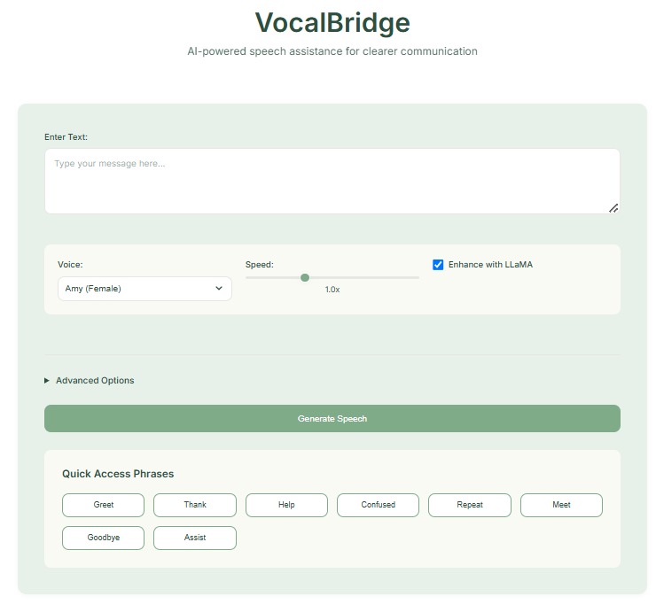

# VocalBridge

A small Flask web app that helps people with speech impairments communicate. The user types or picks a phrase, and VocalBridge speaks it aloud in a natural voice. An optional LLM step can tidy the text first.



## What it does

- **Text to speech** with local [Piper](https://github.com/rhasspy/piper) voices through [yapper-tts](https://pypi.org/project/yapper-tts/): Amy, Arctic, Bryce, Danny, John, Kathleen, Kristin, LJSpeech and Norman.
- **Speech rate** control (slow, normal, fast).
- **Quick phrases**: one-tap buttons for common phrases such as greetings, thanks and asking for help.
- **Optional LLM pass** through the Groq API:
  - *humanize* adds punctuation and natural pauses so the speech sounds less robotic.
  - *enhance* rewrites the text for clarity, and the user reviews it before it is spoken.

If the Groq call fails or no valid key is set, the app falls back to the original text, so plain text to speech still works without an API key.

## How it works

```
browser (index.html)
  -> POST /synthesize  text -> LLMService (Groq): humanized / enhanced text
  -> POST /speak       text -> TTSService (Piper via yapper-tts) -> base64 WAV -> played in the browser
```

| Path | Role |
|------|------|
| `app/routes/main.py` | Flask routes: `/`, `/synthesize`, `/speak` |
| `app/services/llm_service.py` | Groq client for humanize and enhance |
| `app/services/tts_service.py` | Piper voice loading and WAV generation |
| `app/utils/logger.py` | Per-service log files in `logs/` (git-ignored) |
| `app/templates/`, `app/static/` | Web interface |

## Run it

Tested with Python 3.12.

```bash
git clone https://github.com/AnirudhDesai777/VocalBridge.git
cd VocalBridge
python -m venv .venv
source .venv/bin/activate        # Windows: .venv\Scripts\activate
pip install -r requirements.txt
```

Create a `.env` file in the project root:

```env
GROQ_API_KEY=your-groq-api-key   # optional; any placeholder value starts the app without LLM features
```

Then start the server:

```bash
python run.py
```

Open http://127.0.0.1:5000/. The first start downloads the Piper binary and voice models into the yapper-tts data folder.

## Known issues

- The Groq model name in `llm_service.py` (`llama3-70b-8192`) is from late 2024 and has since been deprecated by Groq, so the LLM features need a current model name.
- The app was built and used on Windows. On macOS (Apple Silicon), the web interface loads and the routes respond, but the Piper binary that yapper-tts downloads exits with SIGABRT, so no audio is produced there.

## Future scope

- Use Piper directly instead of through yapper-tts.
- Change speech speed in real time.
- Per-user customisation of voices and phrases.

## Acknowledgments

- [Piper](https://github.com/rhasspy/piper) and yapper-tts for speech synthesis
- Groq for LLaMA model access
- Flask
